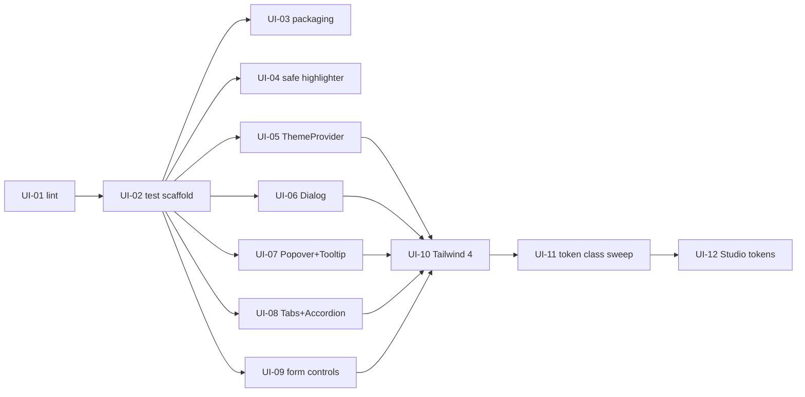

# @frontforge/ui backlog

These are packet-sized tasks for phase 1 (see [REVIEW.md](../../REVIEW.md)). Each one is a single packet. You can build it from the repo state after its dependencies have merged, and it finishes with `npm run check` green. The web backlog lives in `frontforge-labs/web` at `docs/workflow/BACKLOG.md`. Cross-repo dependencies are named as `web#W-nn`.

## Conventions

- **Tier:**
  - `routine`: well-trodden change, standard review.
  - `deep`: security, accessibility semantics, or a migration with wide blast radius; gets the deep review.
  - `design`: visual or UX judgment; needs Fred's eye on the result.
- **Size:** changed lines, excluding files deleted outright.
  - `S`: under 100 lines.
  - `M`: 100–200 lines.
  - `L`: 200–300 lines.
- **Checks:** until UI-02 lands, a task's checks are its own listed commands. From UI-02 on, every task must pass `npm run check` (lint, typecheck, test, build), plus the tests named in the task.
- **Size and codemods:** output from the official `@tailwindcss/upgrade` codemod is committed separately and does not count toward size; only hand-written lines do.
- **Release:** Fred tags releases by hand; this is not a task. Tags go on after UI-03 (`v0.2.0`), UI-04 (`v0.3.0`), UI-11 (`v0.4.0`) and UI-12 (`v0.5.0`). web pins them: W-01 pins v0.2.0, and W-10 pins v0.5.0. The repo is public, so `github:` installs need no credentials, only network access during `npm ci`.

## Order

UI-10 waits for UI-06 to UI-09. They rewrite the same components, so landing the Tailwind 4 change first would leave them writing Tailwind 3 classes that silently generate nothing.

## Tasks

### UI-01 ESLint 9 flat config · routine · S

- **Do:**
  - Add `eslint.config.js` with `@eslint/js`, typescript-eslint (recommended), react-hooks, jsx-a11y, eslint-plugin-storybook and eslint-config-prettier.
  - Remove the `eslintConfig` key from `package.json` and set `"lint": "eslint ."`.
  - Delete the `/stories` template folder.
  - Fix or narrowly disable (with a reason) the errors that surface. Leave the a11y rule hits in overlay components as warnings, because UI-06 to UI-09 fix them.
- **Done when:** `npm run lint` exits 0.

### UI-02 Test, typecheck and check scaffolding · routine · M · after UI-01

- **Do:**
  - Add a `unit` Vitest project (jsdom, `src/**/*.test.ts(x)`, setup file importing `@testing-library/jest-dom/vitest`) next to the existing Storybook project, and add `@testing-library/user-event`.
  - Scripts:
    - `test` = `vitest run --project unit`
    - `test:stories` = the browser project
    - `typecheck` = `tsc --noEmit`
    - `check` = lint, then typecheck, then test, then build
  - Add `.nvmrc` (24) and `.github/workflows/check.yml` running `npm ci && npm run check`.
  - Write the first tests:
    - `utils/cn.test.ts`: conflict merge, falsy inputs.
    - `utils/clipboard.test.ts`: `copyToClipboard` on both the Clipboard API and the `execCommand` fallback (mocked), plus `formatCSS`, `hexToRgb` and `rgbToHex`.
- **Done when:** `npm run check` exits 0 headless with no browser installed, and the new tests pass.

### UI-03 Packaging and installable from git · routine · S · after UI-02

- **Do:**
  - Move `class-variance-authority`, `clsx` and `tailwind-merge` to `dependencies`, and drop `tailwindcss` from `dependencies`.
  - Make `lucide-react` a peer dependency.
  - Fix the exports map so `require.types` points at `./dist/index.d.cts`, and add `./package.json`.
  - Add `"sideEffects": ["*.css"]`.
  - Export `cn`.
  - Add `"prepare": "tsup"` so `npm install github:frontforge-labs/ui#tag` builds `dist`.
  - Add `publint` as a dev dependency and run it in `check` after `build`.
- **Done when:** `npm run check` (now including publint) exits 0. A test imports `cn` from `src/index.ts`.

### UI-04 Safe CSS highlighter · deep · M · after UI-02

- **Do:**
  - Add `src/utils/highlightCss.ts`. It HTML-escapes the input first, then tokenises it (selectors, properties, values, comments) in a single pass, so it never matches inside its own output.
  - Add a shared `useCopyToClipboard` hook that clears its timer on unmount.
  - Use both in CodePanel, CodePreviewPanel and ToolContainer, removing the three copies.
- **Done when:**
  - `highlightCss.test.ts` passes:
    - `</style>` comes out inert.
    - `.5rem` inside a value is not tagged as a selector.
    - Known input produces the expected markup.
  - A hook test passes with fake timers and unmount.

### UI-05 ThemeProvider fixes · routine · S · after UI-02

- **Do:**
  - Resolve `system` synchronously in the state initialiser.
  - Guard `localStorage` access with try/catch.
  - Set `color-scheme` alongside `data-theme`.
  - Memoise the context value.
  - Make ThemeToggle use the provider's cycle and an `aria-label`.
  - Delete the unused `theme/tokens.ts`.
- **Done when:** `ThemeProvider.test.tsx` covers:
  - Stored preference.
  - `system` through a mocked `matchMedia`, including a live change.
  - Blocked storage that throws.
  - The `data-theme` and `color-scheme` attributes.
  - The toggle cycle.

### UI-06 Modal and Drawer on Radix Dialog · deep · M · after UI-02

- **Do:**
  - Rebuild Modal and Drawer on `@radix-ui/react-dialog`: portal, focus trap, initial focus and focus restore, Escape and overlay close, scroll lock, `useId` titles.
  - Keep the public props (`open`, `onClose`, `title`, `size`/`side`), or document any break in the component's story.
- **Done when:** tests pass for both components:
  - The dialog role is labelled by the title.
  - Escape closes it only while open, and does nothing when closed (the Drawer regression).
  - Focus moves in and returns to the trigger.
  - Two instances get distinct ids.

### UI-07 Popover and Tooltip on Radix · routine · M · after UI-02

- **Do:**
  - Rebuild Popover on `@radix-ui/react-popover` and Tooltip on `@radix-ui/react-tooltip`, with a portal and theme tokens instead of inline colours.
  - Tooltip honours `className` and gains a `disabled` prop.
  - Update Sidebar to use `disabled` instead of `className="hidden"`.
- **Done when:** tests pass:
  - Popover: trigger toggles it, outside click and Escape close it, and the child's own `onClick` still fires.
  - Tooltip (fake timers): shows after the delay, hides on blur or Escape, sets `aria-describedby`, and renders nothing when `disabled`.

### UI-08 Tabs and Accordion on Radix · routine · M · after UI-02

- **Do:** rebuild Tabs on `@radix-ui/react-tabs` and Accordion on `@radix-ui/react-accordion`, keeping their current props. Content is no longer clipped at `max-h-96`.
- **Done when:** tests pass:
  - Tabs: arrow keys and Home/End move both focus and selection, and ids are unique across two instances.
  - Accordion: `single` vs `allowMultiple`, and `aria-expanded` toggles.

### UI-09 Form controls · routine · M · after UI-02

- **Do:**
  - Switch:
    - Make it either controlled or uncontrolled, never both at once.
    - Fix the `checked || props.checked` bug.
    - Add a `peer-focus-visible` ring.
    - Put `className` on the wrapper.
  - Checkbox: drop the redundant `role` and `aria-checked`.
  - RadioGroup: add a controlled `value`/`onChange`, use `useId` ids, and drop the stale `aria-checked`.
  - FormField: merge with the child's existing `aria-describedby` instead of overwriting it.
  - Form: use a `useId` title id.
- **Done when:** tests pass for:
  - Switch: controlled `false` with internal true shows off, and both modes fire `onChange`.
  - RadioGroup: controlled selection, and two groups with the same values don't collide.
  - FormField: label `htmlFor`, `aria-invalid`, merged `aria-describedby`.

### UI-10 Tailwind 4 and tokens as CSS · deep · M · after UI-05 to UI-09

- **Do:**
  - Run the `@tailwindcss/upgrade` codemod as its own commit.
  - Then by hand:
    - Use `@tailwindcss/postcss`, or `@tailwindcss/vite` for Storybook.
    - Replace `tailwind.config.ts` with a shipped `theme.css`:
      - An `@theme` block mapping the `--fe-*` variables to colours.
      - `@custom-variant dark` on `[data-theme="dark"]`.
      - The skeleton and slide keyframes.
    - Export it as `@frontforge/ui/theme.css`, keeping `styles.css` as an alias for one release.
  - No class-name sweeps beyond what the codemod does; UI-11 does those.
- **Done when:**
  - `npm run check` exits 0.
  - A test runs the Tailwind compiler (`@tailwindcss/node` `compile`) over a fixture using `bg-accent/20`, `dark:bg-surface-2` and `text-text-muted`, and asserts each produces a rule (opacity through `color-mix`, dark mode keyed on `data-theme`).

### UI-11 Token class sweep · routine · M · after UI-10

- **Do:** replace with tokens:
  - The shadcn-style class names that don't exist: `bg-primary`, `text-primary-foreground`, `text-muted-foreground`, `text-foreground`, `text-muted`.
  - The hard-coded palette colours: Badge, Toast, Breadcrumb, StatsCard, PageHeader, Tooltip, and PreviewPanel and CodePreviewPanel `dark:bg-gray-50`.
  - Also make PageHeader use `cn`.
- **Done when:**
  - `npm run check` exits 0.
  - A test greps `src/**/*.tsx` and fails on any of those class names or on Tailwind palette colours (`(bg|text|border|ring)-(red|green|yellow|orange|blue|gray|white|black)`).

### UI-12 Studio design tokens · design · M · after UI-11

- **Do:**
  - Apply the agreed "Studio" direction in `theme.css`:
    - Dark-first palette: near-black surfaces in 3 levels, one cool accent, and semantic colours.
    - A light theme as the alternate.
    - Font stacks: `"Inter", system-ui, sans-serif` and `"JetBrains Mono", ui-monospace, monospace`.
    - A tighter spacing, radius and shadow scale.
  - The library does not load fonts; the app does (web W-10).
  - Update the Button, Card, Input and Tabs stories to show both themes.
- **Done when:**
  - `npm run check` exits 0.
  - `tokens.test.ts` parses `theme.css` for **both** themes and asserts a contrast of at least 4.5 for each of these pairs:
    - `text` and `text-muted` on `bg`, `surface-1`, `surface-2` and `surface-3`.
    - `accent-foreground` on `accent`.
    - `{success,warning,error,info}-foreground` on its own colour.
    - The test uses a small inline contrast function.
  - Fred signs off on screenshots of the stories.

## Later (not phase 1)

- Move the FrontForge tool shell (ToolContainer, ToolLayout, ToolControlPanel, CodePanel, CodePreviewPanel, PreviewPanel, ControlGroup, FullWidthGroup, Sidebar, AppIcon, ColorInput) out of ui once web owns its own copy (web backlog, "Later"), and bump the major version.
- Toast system (provider, queue, dismiss, timers, `role="alert"` for errors), probably on Radix Toast.
- Navbar and Breadcrumb semantics (`nav`, `ol/li`, `aria-current`, `aria-expanded`).
